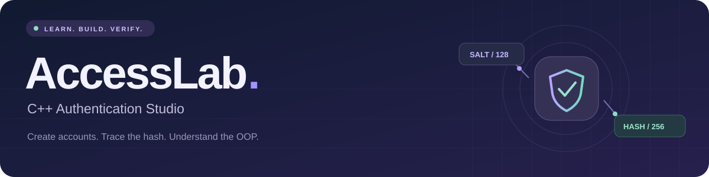
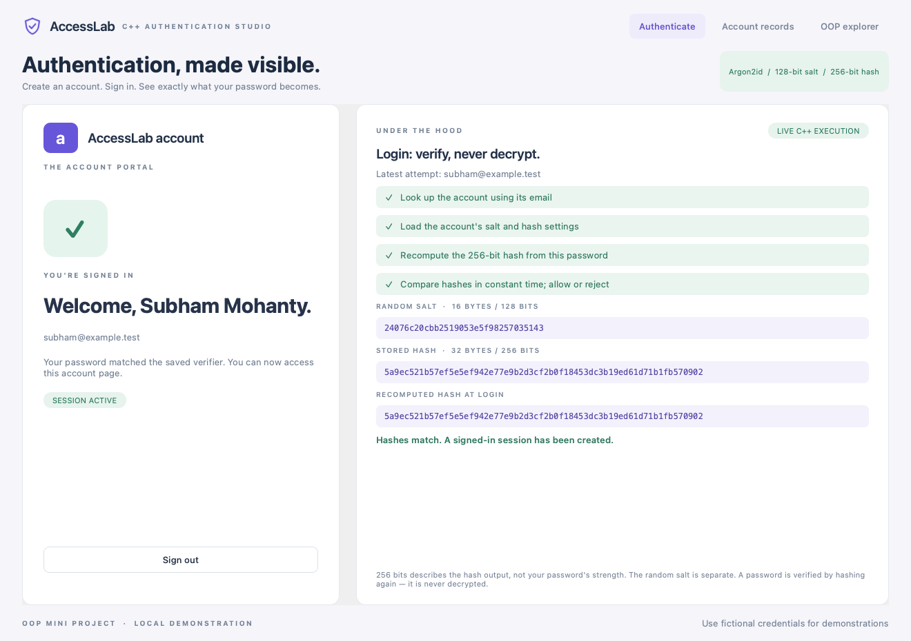
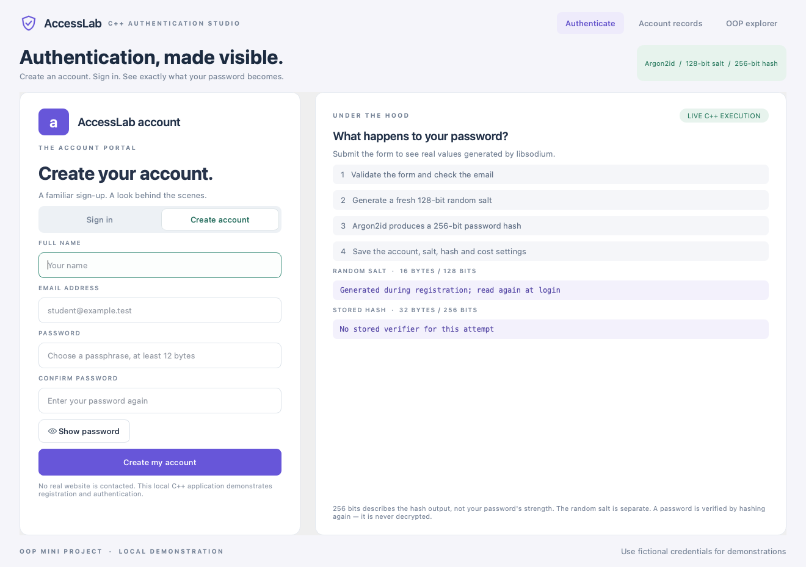
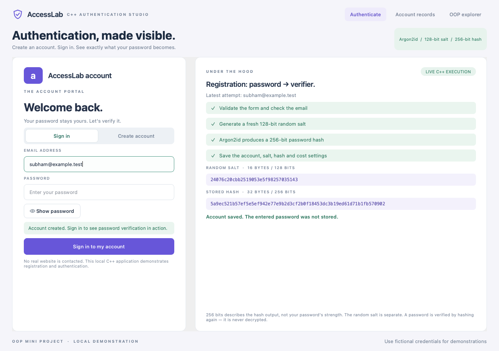
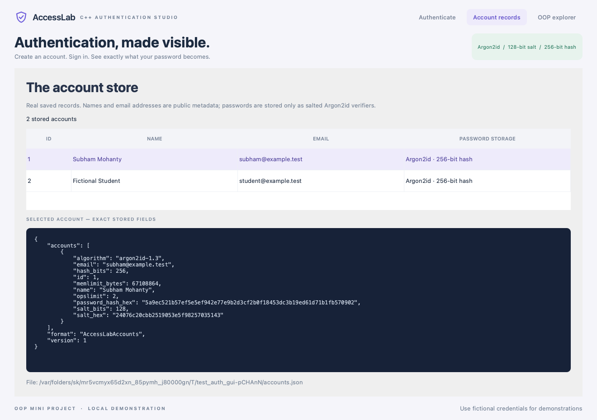
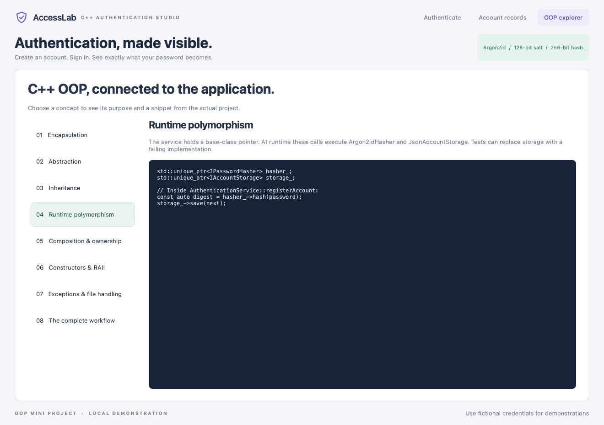
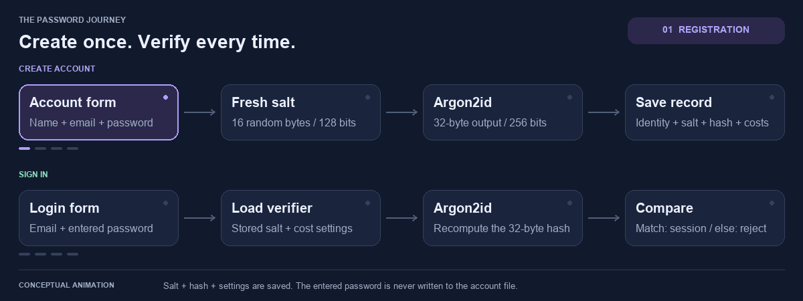
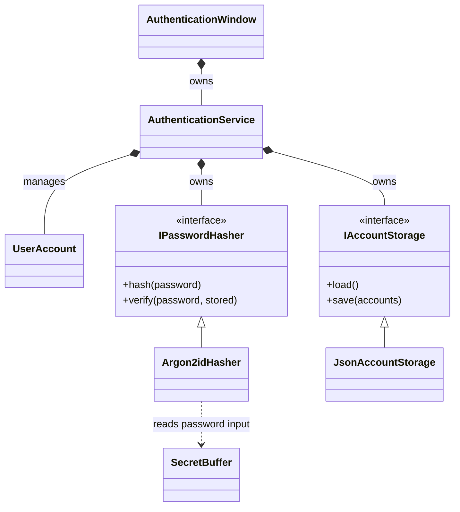

# OOPS-PROJECT
<p align="center">
  
</p>

<p align="center">
  
</p>

<p align="center">
  <strong>A familiar login screen. An open view of what happens behind it.</strong><br />
  Create an account, inspect its salted password hash, and follow the C++ objects that make authentication work.
</p>

<p align="center">
  <a href="#preview">Preview</a> ·
  <a href="#the-password-journey">Password journey</a> ·
  <a href="#oop-in-practice">OOP design</a> ·
  <a href="#build-and-run">Build &amp; run</a> ·
  <a href="#verification">Verification</a> ·
  <a href="docs/Demo_Guide.md">Viva guide</a>
</p>

---

## Meet AccessLab

**AccessLab** is a native **C++17 desktop application** that makes website-style registration and login understandable. Its Qt interface pairs a working account portal with a live explanation panel: the displayed salt, stored hash, and recomputed login hash come from actual libsodium operations.

The application runs locally. Account creation, password verification, persistence, and signed-in state are functional; it does not contact a website or run a web server.

| Create | Inspect | Understand |
| :--- | :--- | :--- |
| Register, sign in, and sign out | See the real salt, hash, parameters, and saved JSON | Explore the OOP concepts behind the running app |

## Preview

[](docs/screenshots/login-success.png)

<p align="center"><sub>Actual application capture with fictional demonstration credentials. Click any screenshot to enlarge.</sub></p>

<details>
<summary><strong>Explore the rest of the interface</strong></summary>

<table>
  <tr>
    <td width="50%" align="center">
      <strong>Create an account</strong><br /><br />
      <a href="docs/screenshots/create-account.png"></a>
    </td>
    <td width="50%" align="center">
      <strong>Watch registration</strong><br /><br />
      <a href="docs/screenshots/registration-process.png"></a>
    </td>
  </tr>
  <tr>
    <td width="50%" align="center">
      <strong>Inspect the saved record</strong><br /><br />
      <a href="docs/screenshots/stored-records.png"></a>
    </td>
    <td width="50%" align="center">
      <strong>Connect it to OOP</strong><br /><br />
      <a href="docs/screenshots/oop-explorer.png"></a>
    </td>
  </tr>
</table>

[See the rejected-login screen →](docs/screenshots/login-rejected.png)

</details>

## The password journey



<p align="center"><sub>Looping conceptual animation of the implemented workflow. The screenshots above show actual app execution.</sub><br /><a href="docs/assets/password-workflow-still.png">Prefer a still image? Open the static workflow.</a></p>

### Create an account

The form validates the name, normalized email, password, and confirmation. **Argon2idHasher** generates a fresh random salt and computes a password hash. **JsonAccountStorage** commits the proposed account collection before the service publishes the new account in memory.

### Sign in

The service loads the account's saved salt and supported cost settings, hashes the entered password again, and compares the resulting bytes using `sodium_memcmp`. A match opens the signed-in account page; a mismatch leaves the user signed out.

| Parameter | Value | What it means |
| :--- | :--- | :--- |
| Algorithm | **Argon2id 1.3** | Memory-hard password hashing supplied by libsodium |
| Random salt | **16 bytes / 128 bits** | Created separately for every new account |
| Hash output | **32 bytes / 256 bits** | Displayed as 64 hexadecimal characters |
| Cost profile | **2 operations / 64 MiB** | Fixed and validated for this project |
| Comparison | **Constant time** | Compares equal-length hash bytes through libsodium |

> **What “256-bit” means:** it describes the hash output size. It is not AES encryption, and it does not give a weak password 256 bits of guessing resistance. Login recomputes a hash; it never decrypts a saved password.

**Try this:** create two fictional accounts with the same password. Their independently generated salts and resulting hashes differ.

<details>
<summary><strong>What is actually written to disk?</strong></summary>

The JSON database contains the account's ID, name, normalized email, algorithm, salt, hash, and cost settings. Password input and confirmation are not serialized. Login does not rewrite the file or store its candidate hash.

| Saved field | Example meaning |
| :--- | :--- |
| `id`, `name`, `email` | Public account identity metadata |
| `algorithm` | `argon2id-1.3` |
| `salt_hex` | The account's random 128-bit salt, hex-encoded |
| `password_hash_hex` | The 256-bit password verifier, hex-encoded |
| `salt_bits`, `hash_bits` | `128`, `256` |
| `opslimit`, `memlimit_bytes` | `2`, `67108864` |

[Open a real record from the fictional registration test](docs/Example_Stored_Record.json) · [Read the full workflow](docs/Password_Workflow.md)

</details>

## OOP in practice

The GUI delegates account behavior to a small C++ class design. Cryptographic operations and file handling stay behind abstract interfaces.



| Concept | Where to find it | Why it matters |
| :--- | :--- | :--- |
| **Encapsulation** | [`UserAccount`](include/UserAccount.h) | Private identity/digest fields, const getters, no plaintext-password member |
| **Abstraction** | [`IPasswordHasher`](include/IPasswordHasher.h), [`IAccountStorage`](include/IAccountStorage.h) | Define operations without exposing library/file details |
| **Inheritance** | [`Argon2idHasher`](include/Argon2idHasher.h), [`JsonAccountStorage`](include/JsonAccountStorage.h) | Implement the abstract contracts with `override` |
| **Runtime polymorphism** | [`AuthenticationService`](src/AuthenticationService.cpp) | Virtual calls through base-class `unique_ptr` members |
| **Composition** | [`AuthenticationService.h`](include/AuthenticationService.h) | Owns accounts, a hasher, and a storage object |
| **RAII & ownership** | [`SecretBuffer`](src/SecretBuffer.cpp) | Noncopyable guarded memory, automatic cleanup, move ownership |
| **Constructors & overloading** | [`SecretBuffer.h`](include/SecretBuffer.h), [`UserAccount.cpp`](src/UserAccount.cpp) | Different buffer constructors and validated account initialization |
| **STL, exceptions & files** | [`JsonAccountStorage.cpp`](src/JsonAccountStorage.cpp) | Bounded reads, duplicate checks, checked persistence, and recoverable errors |

<details>
<summary><strong>See the virtual calls used during registration</strong></summary>

```cpp
// AuthenticationService owns base-class interfaces.
std::unique_ptr<IPasswordHasher> hasher_;
std::unique_ptr<IAccountStorage> storage_;

// The actual implementations are selected through virtual dispatch.
const auto digest = hasher_->hash(password);
storage_->save(next);
```

The production objects are `Argon2idHasher` and `JsonAccountStorage`. Tests can substitute a storage implementation that fails, allowing the same service to prove that an unsuccessful commit creates no phantom account.

[Definitions, actual snippets, and viva answers →](docs/OOP_Explanation.md)

</details>

## Build and run

**Requirements:** a C++17 compiler, CMake **3.22+**, Qt **6.5+** Widgets, and libsodium **1.0.18+**. Automated GUI tests also use Qt Test. Once dependencies are installed, the application runs offline.

Open the project folder containing `CMakeLists.txt`. The commands below run from that folder.

<details open>
<summary><strong>Windows · Visual Studio 2022 · VS Code</strong></summary>

Install **Visual Studio 2022 Build Tools** with **Desktop development with C++**, Git, CMake, and VS Code. Add the recommended **C/C++** and **CMake Tools** extensions.

**Install vcpkg once** if you do not already have it:

```powershell
New-Item -ItemType Directory -Force "$env:USERPROFILE\tools"
git clone https://github.com/microsoft/vcpkg.git "$env:USERPROFILE\tools\vcpkg"
& "$env:USERPROFILE\tools\vcpkg\bootstrap-vcpkg.bat"
```

**Install dependencies, configure, build, and run:**

```powershell
$env:VCPKG_ROOT = "$env:USERPROFILE\tools\vcpkg"
& "$env:VCPKG_ROOT\vcpkg.exe" install libsodium:x64-windows qtbase:x64-windows

cmake -S . -B build -G "Visual Studio 17 2022" -A x64 "-DCMAKE_TOOLCHAIN_FILE=$env:VCPKG_ROOT/scripts/buildsystems/vcpkg.cmake" -DVCPKG_TARGET_TRIPLET=x64-windows
cmake --build build --config Release --parallel
ctest --test-dir build -C Release --output-on-failure
.\build\Release\accesslab.exe
```

Already have vcpkg? Point `VCPKG_ROOT` at it. Already have an official Qt MSVC kit? See [the alternate Qt setup](docs/Setup.md#windows--vs-code). The first vcpkg Qt build can take time.

The `.vscode` folder includes build/test tasks and a Windows launch configuration. For source-level stepping, build **Debug** and update `Release` to `Debug` in `launch.json`.

</details>

<details>
<summary><strong>macOS · Homebrew</strong></summary>

Install Apple developer command-line tools and Homebrew if needed, then:

```sh
brew install cmake pkg-config libsodium qt

cmake -S . -B build -DCMAKE_BUILD_TYPE=Release -DCMAKE_PREFIX_PATH="$(brew --prefix qt)"
cmake --build build --parallel
ctest --test-dir build --output-on-failure
open build/accesslab.app
```

For an official Qt kit, set `CMAKE_PREFIX_PATH` to its `macos` directory instead. The separately supplied Apple Silicon demonstration app targets **macOS 27+**; source builds depend on your compiler and library deployment targets.

</details>

<details>
<summary><strong>Linux · Debian / Ubuntu</strong></summary>

Use a distribution or official Qt kit providing **Qt 6.5+**.

```sh
sudo apt update
sudo apt install build-essential cmake pkg-config libsodium-dev qt6-base-dev qt6-base-dev-tools

cmake -S . -B build -DCMAKE_BUILD_TYPE=Release
cmake --build build --parallel
ctest --test-dir build --output-on-failure
./build/accesslab
```

If the distribution package is older, install a supported official Qt kit and supply `CMAKE_PREFIX_PATH`.

</details>

[Full setup, deployment notes, storage locations, and input limits →](docs/Setup.md)

## A five-minute demonstration

1. **Create** a fictional account and inspect its generated salt and hash.
2. **Sign in incorrectly** and show the different candidate hash and rejected attempt.
3. **Sign in correctly** and show matching hashes and the signed-in account page.
4. **Create a second account with the same password** to demonstrate independent salts.
5. **Open Account records** to inspect the saved JSON, then **OOP explorer** to explain the classes.
6. **Restart** and sign in again to demonstrate persistence.

For an isolated exam file:

```powershell
.\build\Release\accesslab.exe "data\exam-accounts.json"
```

The app starts empty. Screenshots and the example JSON use fictional test accounts; they are not loaded into your own database automatically.

[Open the complete college demo and viva script →](docs/Demo_Guide.md)

## Verification

**28 scenarios passed:** **17 core C++** and **11 C++ GUI** scenarios in two CTest entries.

| Checked behavior | Recorded result |
| :--- | :--- |
| Registration, normalization, duplicates, and validation | Passed |
| Correct, incorrect, and unknown-account login | Passed |
| Fresh salts, 256-bit output, and actual verifier comparisons | Passed |
| JSON persistence, restart, and absence of entered password from saved records | Passed |
| Runtime polymorphism and sensitive-buffer ownership | Passed |
| Malformed files, size limits, locks, and failed writes | Passed |
| GUI forms, record inspection, OOP navigation, and session state | Passed |

**Verification date:** 24 October 2026. **Environment:** macOS 27 / Apple Silicon, AppleClang 21.0.0, CMake 4.4.4, Qt 6.10.0, libsodium 1.0.22. GUI checks used Qt's offscreen platform. Windows/Linux execution and native interactive Cocoa behavior were not independently verified. This is a recorded test result, not a live CI status badge.

[Detailed results](docs/Verification.md) · [Actual test output](docs/Test_Output.txt) · [Core tests](tests/test_auth.cpp) · [GUI tests](tests/test_auth_gui.cpp)

## Project map

```text
AccessLab/
├── gui/                  Native C++ Qt screens, events, and visual styling
├── include/              Account, hashing, storage, service, and memory interfaces
├── src/                  Core C++ implementations and platform file helper
├── tests/                Reproducible C++ core and GUI verification
├── docs/
│   ├── assets/           Repository-local banner, badges, and animated workflow
│   ├── screenshots/      Captures of the compiled application
│   ├── Setup.md          Full installation, deployment, and operating notes
│   ├── OOP_Explanation.md
│   ├── Password_Workflow.md
│   ├── Demo_Guide.md
│   └── Verification.md
├── data/                 Optional isolated demonstration files; git-ignored
├── .vscode/              Editor recommendations, tasks, and launch configuration
├── licenses/             Third-party license texts
├── CMakeLists.txt
└── README.md
```

## Scope and security boundary

AccessLab is an **undergraduate OOP authentication demonstrator**. It models password verification locally; it does not provide a deployed website, HTTPS service, secure web cookies, recovery, MFA, or rate limiting.

- The account file stores **readable identity metadata and password verifiers**. It is not encrypted or authenticated as a whole; someone with write access can replace stored data.
- Record inspection is deliberately available while signed out for teaching with fictional accounts.
- Password input buffers use guarded memory, but Qt, the OS, and conversion temporaries can retain copies.
- The account store is bounded to 500 accounts and 2 MiB, with validated field sizes and a fixed supported hash profile.

[Full limits and operating notes](docs/Setup.md#limits-and-educational-scope) · [Password workflow](docs/Password_Workflow.md)

## Documentation and references

| Read this | For |
| :--- | :--- |
| [OOP explanation](docs/OOP_Explanation.md) | Definitions, code snippets, and short viva answers |
| [Password workflow](docs/Password_Workflow.md) | Registration, storage, login, and bit lengths |
| [Demonstration guide](docs/Demo_Guide.md) | A practical examination walkthrough |
| [Setup guide](docs/Setup.md) | Platform setup, deployment, file locations, and constraints |
| [Verification report](docs/Verification.md) | Executed checks and their practical limits |
| [Third-party notices](THIRD_PARTY_NOTICES.md) | Qt and libsodium components and license information |

Primary technical references: [libsodium password hashing](https://libsodium.gitbook.io/doc/password_hashing/default_phf) · [Qt Widgets C++ API](https://doc.qt.io/qt-6/qtwidgets-index.html).

---

<p align="center">
  <strong>Built by Subham Mohanty</strong><br />
  <sub>C++ · Object-Oriented Programming · Authentication made visible</sub><br /><br />
  <a href="#meet-accesslab">Back to top ↑</a>
</p>
